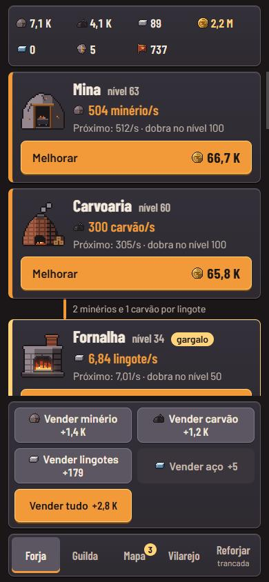
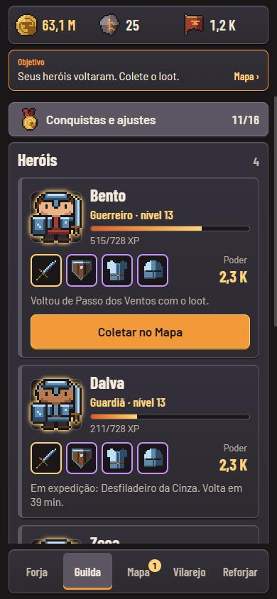
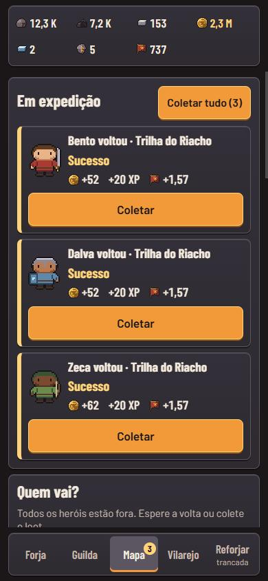
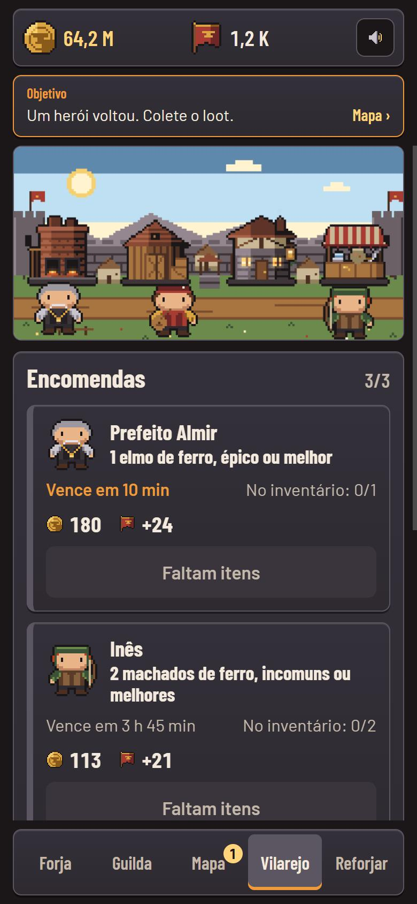
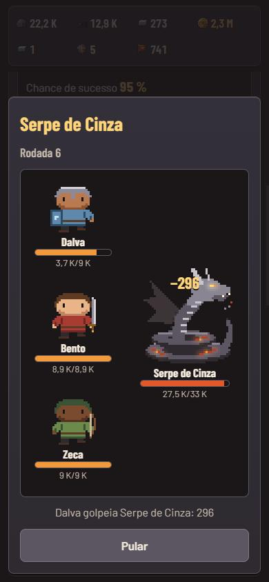
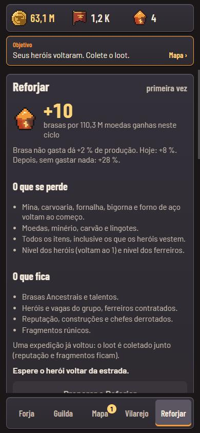

# Brasa & Bigorna

**[▶ Jogar no navegador](https://vitorkw.github.io/brasa-e-bigorna/)**: melhor no celular; dá para instalar como app pelo menu do navegador.

Um jogo idle + tycoon + RPG para o celular, feito como PWA. Você herda uma forja abandonada num vilarejo de fronteira: ela trabalha
sozinha enquanto você decide o que melhorar, o que forjar e quem equipar. Os heróis que usam suas armas derrubam os chefes da região
e, quando o vilarejo vira cidade, você reforja tudo e recomeça mais forte.

**Para quem avalia este repositório.** É um projeto de portfólio com um objetivo técnico claro: regras de jogo como funções puras e
testadas, um simulador que joga o jogo para calibrar o balanceamento e um PWA que abre offline. O jogo roda sem backend, em
React 18 + TypeScript + Vite, com estado em Zustand e save no `localStorage`.

| Forja | Guilda | Mapa |
|---|---|---|
|  |  |  |

| Vilarejo e encomendas | Combate com replay | Reforjar |
|---|---|---|
|  |  |  |

## O jogo em um minuto

1. **Forja.** Mina e carvoaria produzem, a fornalha funde lingotes, a bigorna transforma lingotes em armas, escudos, elmos e armaduras de
   cinco qualidades (comum a lendário). O gargalo da cadeia fica destacado. Um minigame opcional de 3 s (a batida) encurta o caminho para
   a qualidade alta, mas o modo automático sempre avança.
2. **Guilda e Mapa.** Recrute heróis, equipe-os com o que você forjou e mande-os em expedições. O resultado é sorteado na partida; a volta
   é decidida pelo relógio, também com o app fechado. Os chefes (Golem de Escória, Serpe de Cinza) são combates por rodadas, calculados na
   hora, com previsão exata antes de lutar e replay animado.
3. **Vilarejo.** A reputação libera cinco construções (pagas com moedas). Oito moradores fazem encomendas: "2 espadas de ferro, incomuns ou
   melhores, em 3 h", pagas com 1,5 vez o valor e reputação.
4. **Reforjar.** Com a Muralha, o vilarejo vira cidade: tudo zera, você ganha Brasas Ancestrais e compra talentos permanentes.
5. **Sempre.** Fechar o app não para nada (produção offline com teto de 2 a 12 h), e cada abertura mostra o que aconteceu enquanto você
   estava fora. Conquistas, estatísticas locais, venda automática e som (sintetizado, com botão para desligar) completam o MVP.

Visual: a escala de calor do metal é informação (cinza frio = parado, laranja = trabalhando), painéis de aço, Barlow e Barlow Condensed,
sem caixa alta, sem emoji como ícone, um único momento animado por tela. Mobile-first, retrato, alvos de toque de 48 px, sem monetização.

## Como rodar

```bash
npm install
npm run dev        # servidor de desenvolvimento
npm test           # Vitest: regras, save, simulador e renderização de telas
npm run typecheck  # tsc em modo strict
npm run build      # tsc -b && vite build (gera dist/ com o service worker)
npm run preview    # serve o dist/: é aqui que o PWA se instala e funciona offline
npm run sim        # simulador: 2 h contínuas e a sim de dias (~20 s)
npm run sim -- 8   # só a sim contínua, 8 h
npm run sim -- dias # só a sim de dias (até o 2º Reforjar)
```

Requer Node 22.18 ou superior (o Node remove os tipos do TypeScript sozinho, por isso `scripts/sim.ts` roda sem `tsx` nem build).

## Arquitetura

```
src/game/        Regras do jogo: funções puras, sem React, sem relógio, sem Math.random, sem I/O
  constants.ts   Curvas do GDD §4.2 (custos, produção, marcos, preços) e SAVE_VERSION
  state.ts       GameState serializável
  rng.ts         mulberry32: o estado do gerador mora no GameState
  tick.ts        tick(state, dt): produção, fornalha com gargalo, forno, bigorna e venda automática
  offline.ts     applyOffline(state, now): passos de 10 s, teto de horas, resumo
  items.ts, bigorna.ts, batida.ts, ferreiros.ts       itens com qualidade, forja, minigame, passivas
  herois.ts, expedicoes.ts, chefe.ts                   heróis, expedições e combate com log
  construcoes.ts, talentos.ts, bonus.ts, reforjar.ts   vilarejo, árvore de 12 nós, multiplicadores, prestígio
  encomendas.ts  8 moradores, sorteio, prazo, entrega
  conquistas.ts, estatisticas.ts                       16 conquistas e os contadores que elas leem
  inventario.ts  venda manual e automática (por utilidade)
  save.ts        validação e migrações v1 -> v5
  sim.ts         simulador guloso (usa as mesmas funções do jogo)
src/store.ts     Zustand: liga as regras ao localStorage, ao relógio e ao áudio
src/components/  UI (React + motion/react); Sprite.tsx cai para um placeholder se o PNG não existir
src/pwa.ts       registro do service worker e aviso de versão nova
pwa/             modelo do service worker
scripts/         sim.ts (npm run sim) e o plugin do Vite que gera o sw.js
art/             arte como código (pxl) -> public/sprites/*.png
```

**Por que regras puras em `src/game`?** Uma função pura (mesma entrada, mesma saída, sem efeitos) é trivial de testar e roda igual no
navegador, no Vitest e no Node. É assim que o simulador reutiliza o jogo inteiro sem abrir uma aba, e é por isso que cada regra tem
teste unitário. A UI só lê o estado e chama essas funções; o relógio (`Date.now`) e o sorteio inicial entram pela store.

## Decisões técnicas, por fatia

**Fatia 1: offline em passos.** A produção depende de estoque: se a mina para ou o carvão acaba no meio da ausência, um único cálculo
`taxa × tempo` erraria. `applyOffline` simula em passos de 10 s com o mesmo `tick` do jogo online, respeitando gargalos, com teto de
horas (2 h, até 12 h com construção e talentos). Relógio que voltou no tempo é ignorado sem punir. Números são `number`, não `bigint`
(a produção tem frações); o teste do simulador falha se algum valor passar de 1e15, o dia de trocar por `break_infinity.js`.

**Fatia 2: RNG no estado e resultado sorteado antes.** O gerador (mulberry32) vive em `GameState.rng`; cada sorteio devolve
`{ valor, rng }` e quem chama grava o novo estado. Nada nas regras usa `Math.random`, então sim e testes são reproduzíveis. A qualidade
aleatória, o alvo do minigame e o sorteio da segunda peça são gravados **quando a tarefa começa**: fechar o app com o minigame aberto
vale o bônus automático, sem segunda chance. A bigorna trabalha por tarefas (progresso, fila, modo automático), não por taxa.

**Fatia 3: combate determinístico com replay e expedição sorteada na partida.** `simularCombate` não sorteia nada: dano
`max(1, ATQ × 100 / (100 + DEF))`, ordem por VEL, até 30 rodadas, e devolve o log de golpes. A previsão da UI é a mesma função rodando
antes de lutar; o replay só reproduz o log (e vai direto ao resultado com `prefers-reduced-motion`). A expedição sorteia sucesso, fragmento
e loot ao partir e grava o horário de volta: reabrir o app não rerrola, e a volta é só comparar timestamps.

**Fatia 4: bônus em um lugar, prestígio puro, migrações.** `bonus.ts` reúne todos os multiplicadores (brasas, talentos, construções);
as funções de produção, venda e expedição o consultam, e cada talento tem teste na função que muda. `reforjar(estado, agora)` é pura e
devolve o mesmo estado quando algo bloqueia. A reputação das expedições tem retorno decrescente (`15 × horas^0,5 / (1 + reputação/1000)`)
em vez de teto diário, porque um teto diário exigiria um relógio de dia, que o jogo evita por causa de quem adianta o relógio.
`save.ts` tem um registro de migrações testadas (v1 -> v5) e valida o formato atual descartando o que não reconhece, sem corromper o resto.

**Fatia 5: encomendas, conquistas e venda automática.**
- *Encomendas.* Sorteadas pelo RNG do estado e gravadas com prazo em timestamp; o pedido acompanha o progresso (aço só depois do forno,
  qualidade limitada ao que a bigorna entrega com 50 % de chance). Vencida, some sem punição.
- *Conquistas.* 16 funções puras do estado, conferidas a cada tick; os contadores (`stats`) sobrevivem ao Reforjar.
- *Venda automática.* A saída para o inventário de 30 itens que travava a bigorna offline: vende o que não melhora nenhum herói nem serve
  a uma encomenda. Por utilidade, e não por raridade, porque depois do aço quase tudo é raro ou melhor.
- *Recalibração.* A venda automática multiplicou por 2,8 a renda do 1º dia (14,8 M para 41,8 M); o simulador mostrou, e Taverna, Mercado, Muralha e
  Serpe foram reajustados (GDD §4.2, "Notas da fatia 5").

**Fatia 6: tela mais limpa e mais viva** (feita depois do primeiro teste com jogador, que achou o jogo poluído e pouco visual).
- *Próximo objetivo.* `objetivo.ts` lê o estado e devolve uma frase ("Construa a bigorna", "Derrote o Golem no Mapa") com destino e progresso;
  a faixa no topo leva até lá. Substitui o tutorial que o jogo nunca teve.
- *Uma coisa por vez.* Forja em Produção / Bigorna / Ferreiros, Mapa com uma região por vez, barra de recursos que mostra só o que importa
  na aba aberta, e números técnicos ("próximo: 520/s", PV/ATQ dos chefes) fora da tela principal.
- *Cena viva.* Um fundo em pixel art (`art/fatia6.px.js`) com as estações por cima, no DOM, para reagirem ao estado (fogo, fumaça, carrinho,
  ferreiro martelando) e ao dedo. `toque.ts`: cada toque vale uma fração de segundo de produção, com piso no começo, e na bigorna adianta 8 % da peça sem
  nunca terminá-la (o tick continua dono do fim da forja, da batida e do inventário). O sim não toca, então o balanceamento idle não muda.
- *Efeitos.* Moedas voando até o contador, selo "Nível N" ou "Produção x2!" ao melhorar, revelação para peça épica ou lendária (sempre na
  batida; na forja automática, só lendária e no máximo uma a cada 30 s) e heróis andando sobre o banner da região. Tudo some com
  `prefers-reduced-motion`.

**Fatia 7: evolução visível e revisão geral.**
- *Arte em camadas.* Estações ganham uma camada transparente por marco de nível (10/25/50/100) e um nome novo; heróis vestem elmo,
  armadura, escudo e arma por cima do sprite-base (`visual.ts` decide as camadas; `art/fatia7.px.js` desenha). Por serem camadas, valem
  também para a fornalha acesa, a bigorna batendo e o herói andando, sem multiplicar sprites.
- *Toque com limite.* Cada toque vale 0,1 s de produção e a store ignora toques a menos de 100 ms na mesma estação: um dedo rápido soma
  no máximo ~60 % a uma estação, e auto-clicker não quebra a economia.
- *Robustez.* Tela de erro com "Recarregar" no lugar da tela em branco; sprites sem piscar (o resultado do carregamento fica em cache
  síncrono); o brilho de "subiu de nível" não remonta mais o cartão (remontar engolia toques de quem melhora rápido); o aviso de
  conquista saiu de cima do botão de vender.
- *Sem terceiros em tempo de execução.* Fontes no build e backup do save por texto: o jogo não chama nenhum serviço externo.

**Fatia 8: vilarejo vivo, som e combate com impacto.**
- *Vilarejo como paisagem.* Um fundo (`art/fatia8.px.js`) com três casebres e um poço; cada obra entra no seu lote com um salto de poeira,
  a Muralha é uma camada que fecha o horizonte, e os moradores com encomenda aberta andam no primeiro plano (com "!" quando dá para
  entregar). Tocar numa obra, num lote ou num morador mostra o que é.
- *Som sintetizado.* `audio.ts` descreve cada efeito como uma receita de notas (com deslize de frequência) e sopros de ruído filtrado
  (picareta, martelo, fole, golpe), tocada com Web Audio: 20 efeitos e o crepitar da fornalha, sem nenhum arquivo. Os volumes foram
  medidos renderizando cada receita num `OfflineAudioContext` (pico máximo ~0,5 de 1,0). Jogo novo começa com som; o botão fica na barra
  de recursos.
- *Combate.* Quem bate investe, quem apanha leva o tranco e pisca, o golpe que derruba treme a tela, e o chefe desaba.

**Sim guloso de balanceamento.** `simular(horas, passo, opções)` joga o jogo com uma estratégia simples (compra a opção de melhor retorno por
moeda, aloca ferreiros por força bruta, entrega encomendas, equipa o melhor kit, luta quando a previsão dá vitória) e mede os marcos. Com
um padrão de jogador por dias (2 h sem parar no começo de cada ciclo, depois 5 min de sessão a cada 90 min, 8 h de sono, o resto offline
pela `applyOffline` de verdade) ele reproduz uma semana de jogo e é a fonte dos números de balanceamento. Quando uma meta falha, a regra
é ajustar a constante em `constants.ts` ou no módulo da regra e registrar o motivo no GDD, nunca afrouxar o teste.

**Arte como código.** Os sprites são escritos em `art/*.px.js` com o `pxl-pixel-art` (paleta compartilhada em `art/paleta.px.js`) e
exportados para `public/sprites/`. O componente `Sprite` usa o PNG quando existe e cai para um quadrado da paleta com a inicial quando não,
então o jogo roda mesmo sem a arte.

## Testes e simulador

`npm test` roda 384 testes em ~25 s: regras puras, migrações de save, o simulador (que falha se uma meta de ritmo sair da faixa),
renderização das telas no servidor (`renderToString`), contraste de cores e regras de CSS de acessibilidade, o service worker gerado e a
store.

Metas de ritmo do GDD §4.4 e o que o `npm run sim` mede (passo de 1 s):

| Marco | Meta | Resultado |
|---|---|---|
| Primeira compra | < 15 s | 2,8 s |
| Maior intervalo sem comprar nada | ≤ 10 min | 4 min |
| Bigorna liberada | 3 a 8 min | 5 min |
| Primeiro herói | 5 a 15 min | 10 min |
| Golem de Escória | 15 a 40 min | 24 min |
| Segundo herói (150 de reputação) | 30 a 60 min | 42 a 46 min |
| Primeiro épico de ferro | 1 h 30 a 2 h 45 | 2 h 12 min |
| Épicos de ferro nas 3 primeiras horas | < 10 % dos itens de ferro | 8,4 % |
| Lendário de ferro no automático | nenhum em 3 h | nenhum |
| Serpe de Cinza | 18 a 30 h | 24 h 4 min, 29 rodadas |
| Reputação 1 000 | perto da Serpe | 24 h 4 min |
| Muralha | até ~12 h depois da Serpe | 31 h 30 min (7 h 30 depois) |
| Primeiro Reforjar | 2 a 4 dias, 5 a 15 brasas | 52 h 30 min, 13 brasas |
| Segundo ciclo | ≤ 60 % do primeiro | 46 % (24 h contra 52 h 30 min) |

O resultado do 2º Reforjar com 15 brasas e a sensibilidade da data da Taverna (que salta entre 24 h e ~30 h conforme o passo da sim)
estão documentados no GDD.

## PWA

- **Instalável:** `manifest.webmanifest` (nome, cores da paleta, `standalone`, retrato, ícones 192, 512 e maskable) e `apple-touch-icon`.
- **Offline:** service worker **escrito à mão** (`pwa/sw.modelo.js`, cerca de 90 linhas). Escolhi isso em vez do `vite-plugin-pwa`
  (que já suporta o Vite 8) porque o app tem uma tela só e nenhuma rota: o workbox traria centenas de pacotes para resolver um problema que
  cabe em 90 linhas legíveis. Um plugin do Vite (`scripts/pwa-plugin.ts`) grava `dist/sw.js` com a lista de todos os arquivos do build e
  uma versão que é o hash do conteúdo, então um sprite redesenhado também invalida o cache.
- **Estratégia:** cache-primeiro para o app, os sprites e as fontes (que vêm no próprio build, via `@fontsource`, só latim em woff2).
- **Atualização:** o service worker novo espera; o app mostra "Nova versão. Recarregar?" e só troca quando você aceita. O save fica no
  `localStorage`, que a atualização não toca, e o app grava antes de recarregar.
- **Cuidado com `Vary`:** o cache é consultado com `ignoreVary`. O servidor pode responder com `Vary: Origin`, e o script `type=module`
  é pedido com cabeçalho `Origin`, diferente do download da instalação; sem isso o app abria em branco offline (achado no teste
  com o servidor desligado, e coberto por teste).
- **Registro:** feito num `useEffect`, que pode rodar depois do `load`; por isso registra na hora se a página já carregou.
- Para testar: `npm run build && npm run preview`, abrir no Chrome, conferir em DevTools > Application e desligar a rede.

## Acessibilidade

Foco visível (`:focus-visible`), alvos de toque de 48 px, contraste mínimo de 4,5:1 conferido por teste para todas as cores de texto da paleta
(a cor de qualidade nunca é o único sinal: o nome vem escrito), `aria-*` em diálogos, interruptores (`role="switch"`), barras de progresso e
avisos, e `prefers-reduced-motion` respeitado em sprites animados, replay, minigame, avisos e partículas. Há dicas curtas e dispensáveis na
primeira vez de cada mecânica, sem tutorial que bloqueie a tela.

## Limitações conhecidas

- **Relógio do celular.** Sem servidor, não há como saber a hora de verdade. O teto offline limita a produção e um relógio que volta é
  ignorado, mas adiantar o relógio faz as expedições voltarem antes (o dano é limitado: o loot é pequeno perto da produção).
- **Save só local.** `localStorage` com backup do save anterior; limpar os dados do navegador apaga o jogo. Não há sincronização, mas
  em Guilda › Conquistas e ajustes dá para copiar o save como texto e restaurá-lo (inclusive em outro aparelho).
- **Sem navegador nos testes.** Os testes de interface renderizam no servidor; service worker, instalação, toque e desempenho precisam ser
  conferidos à mão no celular.
- **Fragilidade do balanceamento.** A data da Serpe depende da moeda chegar antes ou depois das 16 h acordado de cada dia da sim; ela
  salta entre 24 h e ~30 h com pequenas mudanças de preço (GDD §4.2).
- **Números.** `number` (double) até ~1e15.

## Próximos passos (V2 do GDD)

- Região 3 e um terceiro material.
- Encantamento com fragmentos rúnicos (hoje acumulam sem sumidouro).
- Ponte com o app de treino Forja: código diário que dá "Fôlego" (+20 % de produção por 2 h), com um desafio diário equivalente dentro do jogo.
- Capacitor (Android) e sincronização do save na nuvem.
- Coleta automática do loot de expedição na abertura do app, se virar atrito para quem joga pouco.

## Arte

Os sprites finais ficam em `public/sprites/`: estações de 32x32 (`mina`, `carvoaria`, `fornalha`, `forno_aco`, `bigorna`; versões `_aceso` e
`_batendo` em faixas de 4 quadros), ícones de 16x16 (`icone_*`, `item_<tipo>_<material>`, `talento_<ramo>`, `icone_conquista`), retratos de
24x24 (`ferreiro_<id>`, `heroi_<classe>` e `_andando`, `npc_<id>` dos oito moradores), chefes de 48x48 (`chefe_golem`, `chefe_serpe`),
`construcao_<id>` de 32x32 e banners de região de 96x32. Os ícones do app ficam em `public/icons/` e saem da mesma arte (`app_icone*` em `art/fatia5.px.js`), ampliada sem suavizar por
`node scripts/gerar-icones.ts`. Enquanto um PNG não existe, o `Sprite`
mostra um quadrado da paleta com a inicial.
